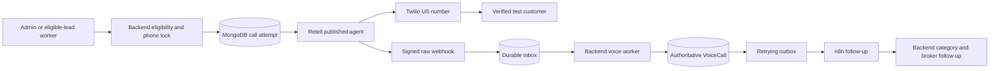

# Retell voice integration

## Configure the unpublished agent after backend deployment

1. Keep RETELL_ENABLED=false and VOICE_AUTO_CALL=false while deploying.
2. Create/open the existing Retell agent. Set its webhook to
   `https://YOUR-API.onrender.com/api/webhooks/retell` and enable call_started,
   call_ended and call_analyzed. Store the API key with the webhook badge as
   RETELL_WEBHOOK_SECRET (or RETELL_API_KEY when it is the same key).
   Retell does not sign with an independently invented webhook secret.
3. Prompt: introduce yourself as NESTR's AI assistant; confirm the enquiry, ask
   about missing location/budget/property/timeline, respect refusal, and end when
   complete. Use provided facts only. Dynamic variables are customer_name,
   customer_phone, lead_source, property_name, property_location,
   customer_inquiry, budget; absent facts are omitted. Configure sensible defaults
   in the agent for missing variables. Choose English/Hindi multilingual support.
4. Configure custom post-call extraction with these exact camelCase names:
   leadCategory (HOT, WARM, COLD, CALLBACK, NOT_INTERESTED, OPTED_OUT),
   customerIntent, requirementsSummary, followUpAction, preferredLocation,
   propertyType, budget, bedrooms (number), purchaseTimeline,
   callbackRequested (boolean), callbackTime (string), optedOut (boolean).
   A call ending alone never qualifies the lead. Missing analysis stays empty.
5. Publish the agent. Put its ID in RETELL_AGENT_ID. Import/connect the Twilio
   US number to Retell using the current SIP trunk guide, assign the outbound
   agent, and set RETELL_PHONE_NUMBER to that E.164 number. Verify India calling
   permissions and route availability with the carrier; +91 caller IDs are not
   supported for Twilio outbound. Retell credits do not replace carrier charges.
6. Set RETELL_TEST_NUMBERS to your verified phone only. Record real consent
   evidence using the lead detail screen. Set RETELL_ENABLED=true. Make one
   confirmed manual call; check Retell call history and your admin transcript.
7. Enable VOICE_AUTO_CALL only after that test. The enquiry form has an optional
   AI callback consent checkbox. Existing DNC status is never cleared by a new
   enquiry. Every five seconds the backend
   checks newly eligible leads with no previous attempt. It calls once during
   09:00–21:00 Asia/Kolkata by default; later attempts require manual action and
   at least 24 hours. Frequency is guarded across lead records by a phone hash.

When N8N_VOICE_OUTBOUND_URL is configured, the eligibility worker notifies that
authenticated workflow and it calls the same backend initiation service. Otherwise
the worker calls the service directly. Render startup supplies both voice workflow
URLs over the private network. Missing/unpublished workflows leave leads uncalled
and retryable; use manual initiation while troubleshooting. No second component
ever calls Retell directly.

The backend alone calls Retell. n8n's authenticated voice-outbound workflow asks
the same backend service to call and cannot bypass consent/DNC/frequency checks.
Manual cancellation is available only while ongoing, using Retell stop-call.
An API timeout leaves status unknown and keeps the lock; inspect Retell history
before another attempt. Never clear locks just because a request timed out.

Incoming signed phone events are persisted now. Existing leads are matched by
the incoming phone number; unmatched calls remain unlinked for review. This does
not create an inbound phone number or an inbound Retell agent. Configure those
in Retell as a later capability. Existing lead facts are not overwritten by AI
extraction. Opt-out immediately suppresses future calls. HOT/WARM enter the
existing broker review queue; CALLBACK stores the request without auto-redial.

Webhook data is durable before HTTP 204. A five-second worker retries expired
leases. n8n failures leave the follow-up pending, and delivery retries cannot
append duplicate follow-up tasks. Raw events expire after seven days. Call
transcripts require admin authentication and are not sent to n8n. Configure
Retell retention/recording consent and MongoDB retention for your deployment.

## APIs

- Admin-authenticated POST/GET `/api/admin/voice/calls`, GET `/:id`, POST
  `/:id/cancel`; creation accepts `{leadId}`. List accepts leadId and page.
- PATCH `/api/admin/voice/leads/:id/consent` accepts callConsent, doNotCall,
  source. The backend records the authenticated admin and timestamp.
- POST `/api/webhooks/retell` requires X-Retell-Signature over exact raw bytes.
- Internal-secret protected `/api/internal/voice/calls` and `/:id/followup`
  are automation interfaces, not a second authentication system.

References: [create call](https://docs.retellai.com/api-references/create-phone-call),
[webhook verification](https://docs.retellai.com/features/secure-webhook),
[custom telephony](https://docs.retellai.com/deploy/custom-telephony).
